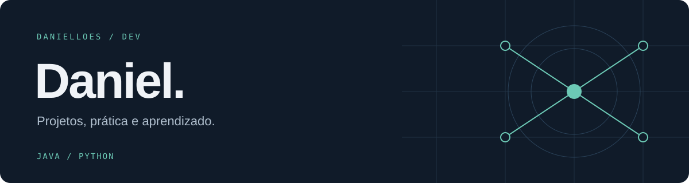

[Repositórios](https://github.com/Danielloes?tab=repositories) &nbsp; / &nbsp; [Contribuições](https://github.com/Danielloes?tab=overview#activity-overview)

### Prazer, Daniel.

Estou reunindo aqui meus projetos em Java e Python. Este espaço mostra o que venho desenvolvendo e aprendendo na prática.

Ainda estou organizando os repositórios e a documentação de cada projeto.

 

<table>
<tr>
<td width="50%" valign="top">
<strong>Meus projetos</strong>  
Java e Python são as linguagens que aparecem nos trabalhos que estou reunindo aqui.
</td>
<td width="50%" valign="top">
<strong>Em construção</strong>  
Novos repositórios, instruções de execução e mais detalhes sobre o que fiz em cada trabalho.
</td>
</tr>
</table>

<strong>Tecnologias presentes nos projetos</strong>

 

Java · Python · Flask · MongoDB · Git

<strong>Meu contato com sistemas distribuídos</strong>

 

Tive um contato inicial com o tema em um projeto de eleição de servidores com heartbeat. É uma experiência pontual; ainda estou construindo minha base nesse assunto.

---

Este perfil vai crescendo junto com os meus projetos.
