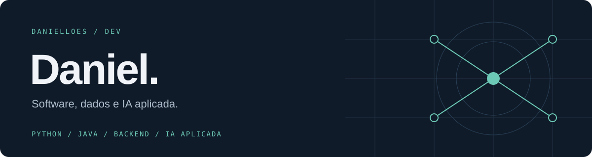

[Projetos em destaque](#projetos-em-destaque) · [Todos os repositórios](https://github.com/Danielloes?tab=repositories) · [Contribuições](https://github.com/Danielloes?tab=overview#activity-overview)

### Sou o Daniel.

Sou estudante e reúno aqui projetos pessoais e trabalhos da faculdade. Tenho usado **Java** para criar aplicações com interface gráfica e praticar orientação a objetos e estruturas de dados. Com **Python**, desenvolvo projetos de dados, APIs e avaliação de assistentes.

Gosto de ver os conceitos funcionando, de uma lista encadeada até uma aplicação que registra despesas, estima uma entrega ou detecta uma regressão no atendimento.

## Projetos em destaque

<table>
<tr>
<td width="50%" valign="top">
<h3><a href="https://github.com/Danielloes/bot-eval-lab">Bot Eval Lab</a></h3>

Laboratório para comparar assistentes de atendimento em português e detectar regressões antes de uma atualização.

<strong>48 conversas fictícias · 49 testes · CI em Windows e Ubuntu</strong>

Python · SQLite · pytest · Embeddings

<a href="https://github.com/Danielloes/bot-eval-lab#demo-em-um-comando">Executar a demo</a> · <a href="https://github.com/Danielloes/bot-eval-lab/blob/main/examples/demo.html">Relatório de exemplo</a>
</td>
<td width="50%" valign="top">
<h3><a href="https://github.com/Danielloes/previsao-de-entrega">Previsão de Entrega</a></h3>

Estima a duração de entregas e o risco de atraso com regressão Ridge, API e painel de consulta.

<strong>Avaliação temporal · Comparação com baselines · Explicação da previsão</strong>

Python · FastAPI · Machine Learning

<a href="https://github.com/Danielloes/previsao-de-entrega#instala%C3%A7%C3%A3o-e-execu%C3%A7%C3%A3o">Executar o projeto</a> · <a href="https://github.com/Danielloes/previsao-de-entrega/blob/main/evaluation_report.json">Avaliação registrada</a>
</td>
</tr>
<tr>
<td width="50%" valign="top">
<h3><a href="https://github.com/Danielloes/personal-finance-manager">Controle Financeiro Pessoal</a></h3>

Aplicativo desktop para registrar receitas e despesas, consultar lançamentos e acompanhar o saldo. Os dados são armazenados em CSV.

Java · Swing · BigDecimal · Arquivos CSV

<a href="https://github.com/Danielloes/personal-finance-manager">Código e instruções</a> · <a href="https://github.com/Danielloes/personal-finance-manager/blob/main/docs/menu.png">Interface</a>
</td>
<td width="50%" valign="top">
<h3><a href="https://github.com/Danielloes/html-structure-validator">Validador de Estrutura HTML</a></h3>

Verifica a abertura e o fechamento de tags com uma pilha encadeada. Interface gráfica e console indicam linha e coluna do erro.

Java · Swing · Pilha · Lista encadeada

<a href="https://github.com/Danielloes/html-structure-validator">Código e instruções</a> · <a href="https://github.com/Danielloes/html-structure-validator/blob/main/docs/validador.png">Interface</a>
</td>
</tr>
</table>

### Fundamentos em prática

**[Estruturas de dados em Java](https://github.com/Danielloes/java-data-structures)** reúne implementações didáticas de listas com array redimensionável, encadeamento simples e duplo, generics e testes.

<strong>Mais trabalhos: jogos e orientação a objetos</strong>

 

- **[Liga 4](https://github.com/Danielloes/connect-four-java)** — jogo no console com tabuleiro 6×7, verificação de vitória e adversário com jogadas aleatórias.
- **[Simulador de embarque](https://github.com/Danielloes/flight-boarding-simulator)** — exercício de modelagem com herança, interfaces e composição; valida assentos, capacidade e peso.
- **[Registros de alunos](https://github.com/Danielloes/student-record-manager)** — leitura de arquivos binários, ordenação por nota e exportação em texto UTF-8.
- **[Controle de despesas](https://github.com/Danielloes/expense-tracker)** — exercício de polimorfismo com uma interface comum para calcular diferentes despesas usando BigDecimal.

<strong>Ver as interfaces dos aplicativos</strong>

 

**Controle financeiro**

**Validador de HTML**

<strong>O que esses trabalhos colocam em prática</strong>

 

| Trabalho | Conceitos presentes |
| :--- | :--- |
| Controle financeiro | Modelagem de classes, enums, valores monetários e leitura/gravação de arquivos |
| Validador HTML | Uso de pilha, análise de texto, tratamento de erros e interface Swing |
| Estruturas de dados | Generics, redimensionamento de arrays e manipulação de referências entre nós |

---

Projetos pessoais e trabalhos da faculdade. Documentação e instruções de execução nos repositórios.
